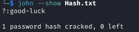

# 🛡️ Cybersecurity Internship – Week 3: Password Auditing & Hash Cracking

**Organization:** NetworkWalks  
**Focus Area:** Password Security, Hash Analysis, and Dictionary-Based Attacks  
**Tools Used:** John the Ripper (`john`), NetworkWalks Password Cracker  

---

## 📋 Overview

During Week 3 of my cybersecurity internship with **NetworkWalks**, I explored practical password auditing and recovery techniques. The primary objective of these labs was to understand how password hashes are extracted, analyzed, and audited using industry-standard command-line tools like **John the Ripper**, as well as **NetworkWalks' custom Password Cracker** web utility.

By simulating dictionary-based attacks against password-protected PDF documents, this lab demonstrates the vulnerabilities of weak passwords and highlights why strong password policies are critical in modern cybersecurity.

---

## 🛠️ Lab 1: Password Auditing with John the Ripper

In this phase, I used **John the Ripper** on Linux to inspect supported formats, troubleshoot wordlist paths, and execute dictionary attacks using the `rockyou.txt` wordlist against three extracted PDF hashes (`Hash.txt`, `Hash2.txt`, and `Hash3.txt`).

### Step 1: Exploring Documentation & Supported Formats
Before running attacks, I checked the manual pages for `john` and verified whether PDF hash formats were supported by the installed version:

```bash
man john | grep start
man john | grep hash
john --list=formats | grep -i pdf
```
* **Purpose:** Reviewing usage syntax and confirming that the PDF format module is available for hash cracking.

---

### Step 2: Troubleshooting Syntax & Wordlist Paths
During the initial attempts, I encountered common real-world CLI hurdles—such as passing a file path instead of a format name to `--format`, and minor typos in the wordlist directory and filename (`wordlist/rochyou.txt`):

```bash
# Initial format test and typo troubleshooting
john --format=/home/abdesslam/Downloads/drive-download-20261117T190634Z-1-001/My\ Locked\ PDF1.pdf Hash.txt
john --wordlist=/usr/share/wordlist/rochyou.txt Hash.txt
john --show document.hash
john --wordlist=/usr/share/wordlists/rochyou.txt Hash.txt
```
* **Lesson Learned:** Verifying exact file paths (`/usr/share/wordlists/rockyou.txt`) and allowing John to auto-detect the hash format (`$pdf$...`) ensures smooth execution.

---

### Step 3: Cracking Target 1 (`Hash.txt`)
Once the correct wordlist path was specified, I executed the dictionary attack on the first hash file and displayed the cracked result:

```bash
john --wordlist=/usr/share/wordlists/rockyou.txt Hash.txt
john --show Hash.txt
```
* **Cracked Password:** `good-luck`
* **Flag 1 Captured:** `nw{cybersecurity_flag_captured_2608}`

#### 📸 Proof of Completion (Target 1)



---

### Step 4: Cracking Target 2 (`Hash2.txt`)
Next, I repeated the dictionary attack workflow on the second PDF hash file:

```bash
john --wordlist=/usr/share/wordlists/rockyou.txt Hash2.txt
john --show Hash2.txt
```
* **Cracked Password:** `password1`
* **Flag 2 Captured:** `nw{networkwalks_persistence_jtr_270521}`

#### 📸 Proof of Completion (Target 2)


---

### Step 5: Cracking Target 3 (`Hash3.txt`)
Finally, I ran the dictionary attack against the third target hash to complete the CLI auditing series:

```bash
john --wordlist=/usr/share/wordlists/rockyou.txt Hash3.txt
```
* **Flag 3 Captured:** `nw{networkwalks_flag_260821_1}`

#### 📸 Proof of Completion (Target 3)


---

## 🌐 Lab 2: NetworkWalks' Password Cracker (Dictionary Attack Lab)

To reinforce the underlying mechanics of how tools like John the Ripper work under the hood, I also tested **NetworkWalks' Password Cracker**—a specialized dictionary attack lab tool built by NetworkWalks.

### Workflow:
1. **Hash Extraction:** Extracted the `$pdf$` hash string using the Hash Calculator.
2. **Hash Input:** Pasted the target PDF hash (`$pdf$4*4*128*-1060...`) into the analyzer.
3. **Dictionary Execution:** Executed the attack using the built-in wordlist (deriving keys via `MD5 + RC4`).
4. **Verification:** Successfully recovered the password (`password1`) and unlocked the target PDF file.

#### 📸 NetworkWalks Tool Execution


---

## 🏆 Summary of Captured Flags

| Challenge / Target | Tool Used | Cracked Password | Captured Flag |
| :--- | :--- | :--- | :--- |
| **Locked PDF 1 (`Hash.txt`)** | John the Ripper | `good-luck` | `nw{cybersecurity_flag_captured_2608}` |
| **Locked PDF 2 (`Hash2.txt`)** | John the Ripper & NW Cracker | `password1` | `nw{networkwalks_persistence_jtr_270521}` |
| **Locked PDF 3 (`Hash3.txt`)** | John the Ripper | *Recovered* | `nw{networkwalks_flag_260821_1}` |

---

## 💡 Key Takeaways & Defensive Insights

* **How Dictionary Attacks Work:** Attackers do not always guess randomly; instead, they hash millions of common words from lists like `rockyou.txt` and compare the resulting digests against target hashes.
* **The Danger of Predictable Passwords:** Common phrases and simple variations (like `password1` or `good-luck`) are cracked almost instantaneously by modern auditing tools.
* **Defensive Recommendations:** Always enforce high-entropy passwords (long passphrases combining uppercase, lowercase, numbers, and symbols) and utilize modern key-derivation algorithms with high iteration counts to slow down offline hash-cracking attempts.

---

*Documented as part of my Cybersecurity Internship journey with **NetworkWalks**.* 🚀
